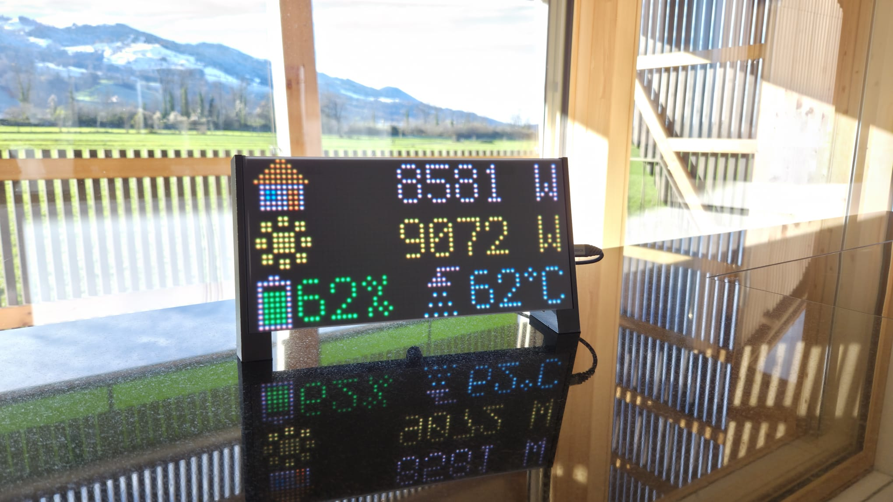
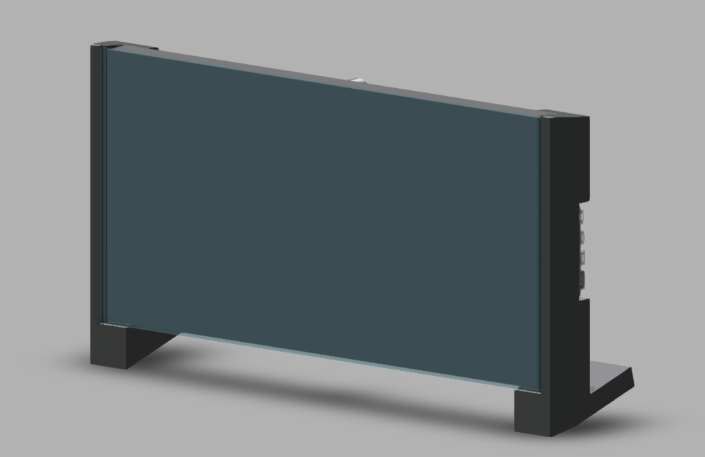

Diese Seite beschreibt den Eigenbau eines **kostengünstigen, lokal betriebenen und langlebigen LED-Displays** mit 2'048 Pixel für den [Solar Manager](https://www.solarmanager.ch/).

Die Firmware – also der Code, der auf dem Microcontroller läuft – ist im dazugehörigen GitHub-Repository verfügbar und dort in englischer Sprache dokumentiert:

🔗 **[GitHub-Repository des Projekts](https://github.com/philippbruhin/solar-manager-matrix-display/)**

Auf dieser Seite erkläre ich ergänzend die Idee hinter dem Projekt, die wichtigsten Entscheidungen und den praktischen Aufbau.

Das Projekt richtet sich an alle technisch Interessierten, die das Display nachbauen möchten. **Programmierkenntnisse sind nicht zwingend notwendig**. Ein grundlegendes Interesse an Microcontrollern, der Programmiersprache Python und Netzwerken hilft jedoch.

## Ausgangslage

Im Herbst 2025 wurde bei uns eine neue Solaranlage installiert, die durch den [Solar Manager](https://www.solarmanager.ch/) gesteuert wird.

Der Solar Manager ist ein **Edge-Computer**, der den **Eigenverbrauch optimiert** und dafür sorgt, dass möglichst viel des erzeugten Solarstroms direkt im Haushalt genutzt wird. Er eignet sich sowohl für Anwender, die einfach einen automatisierten Betrieb wünschen, als auch für Technikbegeisterte, die ihre Energiedaten im Detail analysieren möchten.

Besonders praktisch ist die **Herstellerunabhängigkeit**: Geräte unterschiedlichster Marken lassen sich problemlos einbinden. In meinem Setup laufen unter anderem:

- eine **Hoval-Wärmepumpe**
- eine **Zaptec-Ladestation**
- ein **Huawei-Wechselrichter inkl. Batteriespeicher**
- ein **Boiler-Heizeinsatz**
- zwei **Entfeuchtungsgeräte**
- eine **Warmwasserbegleitheizung**

Die App und das Webportal des Solar Managers bieten bereits umfangreiche Informationen zu den Geräten, dem Eigenverbrauch und der Solarproduktion. Für den Wohnbereich wünschte ich mir jedoch eine **stets sichtbare, bewusst reduzierte und fest installierte Anzeige**, die ohne Interaktion auskommt und nur die wichtigsten Werte zeigt.

Es gibt bereits fertige Lösungen wie [Tablet-Displays](https://www.solarmanager.ch/tabletkonfiguration/) oder [LED-Anzeigen](https://www.solarmanager.ch/solarleistung-via-solar-manager-auf-smart-displays-anzeigen). Sie funktionieren gut, sind aber oft nur begrenzt anpassbar.  

Daher entstand die Idee zu einem **Eigenbau**, der sich exakt auf die eigenen Bedürfnisse abstimmen lässt.

## Hardwarewahl

Für das Projekt verwende ich ein LED-Matrix-Set von Adafruit. LED-Matrix-Displays bieten eine klare, minimalistische Darstellung und eignen sich dank ihres geringen Stromverbrauchs, ihrer Robustheit und ihres günstigen Preises ideal für eine dauerhaft sichtbare Statusanzeige. Gleichzeitig lassen sich damit beeindruckende Effekte realisieren, fast wie ein kleiner Times Square im Wohnzimmer.

Das Set von Hersteller Adafruit besteht aus einem **64×32-Pixel RGB-LED-Panel** und einem dazugehörigen **RGB Matrix Controllerboard**.

- Hersteller-Webseite: [www.adafruit.com/product/4812](https://www.adafruit.com/product/4812)  
- Gekauft bei DigiKey, Preis ca. **CHF 60.–** inklusive Versand

Das Set enthält alles, was für den Betrieb nötig ist. Lediglich das USB-Netzteil hat einen **US-Stecker** und muss ersetzt oder mit einem Adapter betrieben werden.

### Aufbau des Controllers (Adafruit Matrix Portal M4)

Der **Adafruit Matrix Portal M4** kombiniert zwei Chips:

- **SAMD51** → führt den Python-Code aus und steuert das Display  
- **ESP32** → übernimmt die WLAN-Verbindung  

Schliesst man das Adafruit-Board per USB-C an, meldet es sich am PC als Massenspeichergerät. Die Programmierung erfolgt, indem man die Python-Skripte direkt auf dieses Laufwerk kopiert. Weitere Software oder Treiber werden nicht benötigt.

## Programmierung

Das Set kann sowohl mit **Arduino (C)** als auch mit **CircuitPython** programmiert werden. Ich habe mich für Python entschieden, weil es:

- sehr einsteigerfreundlich ist  
- ohne klassische Entwicklungsumgebung auskommt  
- sofort ausgeführt wird (kein Kompilieren)  
- ideal für REST-API-Abfragen ist  

Der komplette Quellcode liegt im Ordner `CIRCUITPY` des [GitHub-Repositories](https://github.com/philippbruhin/solar-manager-matrix-display/).

Das Programm ist bewusst schlank gehalten und besteht aus nur fünf Python-Dateien.

# Funktionsweise des Displays

Die Anzeige zeigt gleichzeitig vier zentrale Werte, dargestellt mit 10×10-Pixel-Icons:

- 🏠 **Hausverbrauch**  
- ☀️ **Solarproduktion**  
- 🔋 **Batteriestand**  
- 🚿 **Boiler-Temperatur**

Die Daten werden **einmal pro Minute** über die **lokale REST-API** des Solar Managers abgefragt.

Das Gerät ist **nicht mit dem Internet verbunden**. Die Kommunikation bleibt vollständig im lokalen Netzwerk. Eine Authentifizierung ist daher nicht nötig.

Grundsätzlich wären auch Echtzeit-Updates via WebSocket möglich. Ich verzichte jedoch bewusst darauf: Die Anzeige soll *ruhig und stabil* sein und nicht bei jeder kleinen Schwankung sofort wechseln.

## Gehäuse und Montage

Für das Display wurde ein passender Halter in **[Fusion 360](https://www.autodesk.com/products/fusion-360/personal)** konstruiert. Fusion ist ein CAD-Programm, welches für den privaten Gebrauch kostenlos genutzt werden darf.

Unterstützung bei Konstruktion und der 3D-Druck-Fertigung erhielt ich von der [Ibex3D GmbH](https://ibex3d.ch/). Vielen Dank dafür.

Das Gehäuse kann im folgenden Viewer betrachtet werden. Es lässt sich entweder selbst drucken oder direkt bei Ibex3D bestellen.

👉 **[`f3z`-Datei herunterladen](./assets/Matrix_Display_Frame_V5.f3z)**

# Fazit

Dieses Projekt bietet eine einfache Möglichkeit, eine **lokale, jederzeit sichtbare Energieanzeige** für den Solar Manager aufzubauen. Die Lösung ist **günstig**, **einfach nachzubauen**, **stabil im Alltag** und sie lässt sich beliebig erweitern.

Eine minimale Einschränkung betrifft die **Helligkeit** des Panels: Obwohl theoretisch Werte zwischen `0` und `1` möglich sind (`display.brightness = 0.5` zum Beispiel), kennt das Display praktisch nur „aus“ oder „volle Helligkeit“. Für den Tagesbetrieb reicht das völlig. Nachts wäre eine feinere Dimmung wünschenswert gewesen.

Abgesehen davon ist das Projekt sehr **flexibel**. Weitere Messwerte können problemlos ergänzt werden, und der Code bleibt dank Python gut verständlich und anpassbar.

Ich freue mich über **Feedback, Hinweise, Ideen oder Pull Requests** auf [GitHub](https://github.com/philippbruhin/solar-manager-matrix-display). Viel Spass beim Nachbauen und Weiterentwickeln! 🚀🔧☀️
